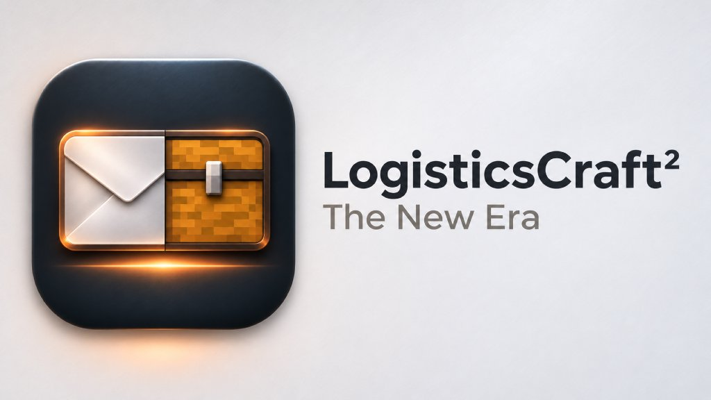

<h1> LogisticsCraft²: The New Era (<code>lc2</code>)</h1>

[简体中文](README.md) · **English**



LogisticsCraft²: The New Era (`lc2`) is a logistics addon for [IndustrialCraft²: The New Era](https://github.com/spectrum527/IndustrialCraft2-The-New-Era). It adds autonomous electric cargo boats and transport drones that keep moving through unloaded chunks, along with a Communication Base Station and Operation Terminal for remote station control.

## Download and install

Install [IndustrialCraft²: The New Era](https://github.com/spectrum527/IndustrialCraft2-The-New-Era) (`ic2` v1.0.5 or newer) for your Minecraft version first, then put the matching `lc2` JAR into `mods/`. In multiplayer, install the mod on both the client and the server.

[v1.2.1 release notes](https://github.com/spectrum527/LogisticsCraft2-The-New-Era/releases/tag/v1.2.1) · [SHA-256 checksums](https://github.com/spectrum527/LogisticsCraft2-The-New-Era/releases/download/v1.2.1/SHA256SUMS.txt)

| Minecraft | Loader | Java | Download |
| --- | --- | ---: | --- |
| 1.19.2 | Forge 43.5.0 | 17 | [Forge 1.19.2 JAR](https://github.com/spectrum527/LogisticsCraft2-The-New-Era/releases/download/v1.2.1/lc2-forge-1.19.2-1.2.1.jar) |
| 1.21.1 | NeoForge 21.1.265 | 21 | [NeoForge 1.21.1 JAR](https://github.com/spectrum527/LogisticsCraft2-The-New-Era/releases/download/v1.2.1/lc2-neoforge-1.21.1-1.2.1.jar) |
| 26.1.2 | NeoForge 26.1.2.128 | 25 | [NeoForge 26.1.2 JAR](https://github.com/spectrum527/LogisticsCraft2-The-New-Era/releases/download/v1.2.1/lc2-neoforge-26.1.2-1.2.1.jar) |
| 26.2 | NeoForge 26.2.0.95 | 25 | [NeoForge 26.2 JAR](https://github.com/spectrum527/LogisticsCraft2-The-New-Era/releases/download/v1.2.1/lc2-neoforge-26.2-1.2.1.jar) |

## Getting started

The mod has two transport systems plus remote scheduling: water routes using the Smart Port and Electric Smart Cargo Boat, air routes using the Cargo Station and transport drones, and remote control using the Communication Base Station and Operation Terminal. Both station types share the same cargo layout, power rules, and upgrade slots. You can check crafting recipes in JEI/EMI or in [docs/DESIGN.md](docs/DESIGN.md).

### Station inventory and power

Each Smart Port and Cargo Station has 54 internal cargo slots split into two 27-slot zones so incoming cargo does not get loaded right back onto outgoing vehicles.

The left half is Outbound (27 slots). Hoppers, pipes, and IC2 Pulling Upgrades insert items here, and departing boats or drones load from here before pulling extra cargo from adjacent containers. A vanilla redstone comparator reads only the Outbound slots, so you can wire a simple circuit to launch when stock arrives or when the buffer fills up.

The right half is Storage (27 slots). Arriving vehicles unload into adjacent containers first and leave any overflow here. Hoppers, pipes, and IC2 Ejector Upgrades extract only from Storage. To relay or send back received items, click the Swap button (`<->`) between the two grids to trade all 27 Outbound slots with all 27 Storage slots at once.

Stations accept power in two ways, and a toggle in the top bar switches between EU First and Bat First. If the preferred source does not cover the full trip cost, the station falls back to the other source without splitting the cost between them.

- EU power connects on all six faces via IC2 cables. Each station stores up to 14,400 EU and accepts LV input (32 EU/t) by default.
- The battery slot on the right accepts only IC2 Single-Use Batteries (`ic2:single_use_battery`).

### Waterway routes: Smart Port and cargo boat

Boats work well for bulk hauling across open water or dug canals. Each Electric Smart Cargo Boat (`lc2:electric_cargo_boat`) has a 54-slot hold, the same size as a double chest.

1. Place a Smart Port (`lc2:smart_port`) at each water edge with its front facing the water (rotate it with an IC2 wrench if needed). Make sure a continuous path of water connects the two ports; even a 1-block canal works.
2. Right-click the starting Smart Port with an Electric Smart Cargo Boat item, or place the boat on the water right next to the port to dock it. While the boat is docked, sneak-right-click to open its cargo hold or right-click to sit inside.
3. Open the port GUI to name the station, pick a target port in the same dimension with `<` and `>` (or enter X, Y, Z coordinates manually and click Set), toggle auto-return if needed, and supply EU or single-use batteries.
4. Put cargo into Outbound (or place chests next to the port), then click Launch in the GUI or power the port with redstone.

A one-way trip costs 3,000 EU or 2 single-use batteries. Turning on auto-return doubles the departure cost to 6,000 EU or 4 batteries, and the boat returns on its own after unloading. To ride along, sit in the boat before redstone launches it. You cannot board a boat once it is underway. On waterways 3 blocks wide or more, boats keep to the right, and in narrow canals they yield to avoid deadlocks.

### Airway routes: Cargo Station and drones

Drones fly straight over terrain and can run several routes at once. Each Cargo Station (`lc2:cargo_station`) has 6 landing bays on top.

1. Place a Cargo Station at each end with open air above it for vertical takeoff and landing. Open the GUI and install an RF Chip in the chip slot; the station will not launch without one.
2. Put one or more Transport Drones (`lc2:transport_drone`) or Heavy Transport Drones (`lc2:heavy_transport_drone`) into the 6 bay slots in the GUI. Parked drones render on top of the block.
3. Select a target Cargo Station within RF range in the same dimension, supply EU or single-use batteries, load items into Outbound, and click Launch or apply a redstone signal. The station checks for a free bay at the destination and reserves it on takeoff. If all 6 target bays are full, the drone will not take off.

One-way energy cost depends on the Manhattan distance (`|dx| + |dy| + |dz|`) between stations. Heavy drones carry three times as much cargo at twice the energy cost.

| RF Chip | Max range | Transport Drone (12 slots, 16 blocks/s) | Heavy Transport Drone (36 slots, 10 blocks/s) |
| --- | ---: | --- | --- |
| RF Chip I (`rf_chip_1`) | 256 blocks | 800 EU or 1 battery | 1,600 EU or 2 batteries |
| RF Chip II (`rf_chip_2`) | 512 blocks | 2,000 EU or 2 batteries | 4,000 EU or 4 batteries |
| RF Chip III (`rf_chip_3`) | 1,024 blocks | 7,000 EU or 5 batteries | 14,000 EU or 10 batteries |

With auto-return turned on for a drone route, the origin station pays for the outbound flight and the destination station pays for the return trip after unloading. If the destination lacks energy or the origin has no free bay, the drone stays parked at the destination and retries once power and a bay open up. Opposing flights and overlapping routes cruise at separate altitudes, and drones change height if two paths come close.

### Remote Control: Communication Base Station & Operation Terminal

To inspect stations, change targets, or launch vehicles from anywhere in the same dimension, place a **Communication Base Station** beside your stations and carry an **Operation Terminal** (target chunks must be loaded and the base station must stay powered).

1. **Place and power a Communication Base Station**: Put a Communication Base Station (`lc2:comm_base_station`) directly face-adjacent to up to **6** Smart Ports or Cargo Stations. It has no GUI of its own; right-click it without a terminal to view its online status, stored power, and linked stations on the actionbar. All six faces accept both **IC2 EU** and **FE** (`1 EU = 4 FE`) up to **LV 32 EU/t (128 FE/t)** into a **4,000 EU (16,000 FE)** buffer, with a **2 EU/t (8 FE/t)** standby drain.
2. **Bind and charge an Operation Terminal**: Right-click a Communication Base Station while holding an Operation Terminal (`lc2:operation_terminal`) to bind it (works even if unpowered or unattached, up to **256** bindings per terminal). Sneak-right-click the base station with the terminal, or click `×` in the terminal list, to unbind. The terminal holds **10,000 EU (40,000 FE)** at LV **32 EU/t (128 FE/t)** and recharges in IC2 chargers (BatBox, CESU, MFE, MFSU, ChargePads, Charging Batteries, and BatPacks) as well as **FE item chargers**.
3. **Open the selection screen**: Right-click air or another block with the terminal, or press the hotkey (default **`G`**, which also finds a terminal in your inventory or a Curios `charm`/`belt` slot). The screen shows a flat, deduplicated, online-first list of bound stations in your current dimension with unlimited range, live search, manual refresh, status LEDs, and per-row unbind controls.
4. **Remote read-only scheduling and energy cost**: Click **Connect** on an online station to open its GUI remotely, complete with a **Remote Read-Only** indicator and a **Back** button in the header. To avoid wireless item teleportation, all machine slots are strictly **read-only**, while renaming, target selection, auto-return, energy priority, Outbound/Storage Swap (`<->`), and **Launch** remain usable.
   - **Energy rule**: Browsing, viewing, and changing settings cost **0 EU** (even at `0 EU`, you can still inspect and configure stations). Only a **successful remote launch** deducts **100 EU (400 FE)** from the terminal (failed launches cost nothing, and Creative mode bypasses the cost).
   - **Live disconnect guard**: If you change dimensions, the chunk unloads, the base station loses power or breaks, the station is removed or no longer adjacent, or the bound terminal leaves your inventory/Curios, the remote GUI closes immediately with a status message.

### Unloaded chunks and mod integrations

Once a boat or drone leaves loaded chunks, the server continues moving it in the background without loading intermediate chunks. Vehicles reappear as normal entities when they enter loaded chunks, and active trips survive world restarts.

To keep stations dispatching, unloading, and reachable via a Communication Base Station while no player is nearby, place a Chunk Loading Upgrade (`lc2:chunk_loading_upgrade`) in the upgrade slots at the start and end stations. It drains 2 EU/t to keep a 3x3 chunk area around the station loaded, and releases the chunks right away if power runs out or you remove the upgrade.

Both stations and the Communication Base Station connect directly to IC2 EU cables and work with the IC2 wrench. Stations transfer items with adjacent vanilla chests, double chests, barrels, shulker boxes, and IC2 storage boxes, and their 4 upgrade slots accept IC2 Transformer, Energy Storage, Overclocker, Ejector, Advanced Ejector, Pulling, Advanced Pulling, and Redstone Inverter upgrades.

Optional integrations (no hard dependencies):
- **IC2 & FE Energy**: Operation Terminals recharge in IC2 EU chargers and FE item chargers; Communication Base Stations accept both IC2 EU and FE on all six faces (`1 EU = 4 FE`).
- **The One Probe, Jade, and WTHIT**: Hovering over a Communication Base Station (or logistics station) displays live online status, EU/FE energy, and linked adjacent stations.
- **Curios**: Equip the Operation Terminal in `charm` or `belt` slots and open it anytime with **`G`**.
- **JEI and EMI**: Full recipe lookup plus built-in info pages for the Communication Base Station and Operation Terminal.

## Build from source

### Requirements

- JDK matching your target version: Java 17 for Forge 1.19.2, Java 21 for core tests and NeoForge 1.21.1, and Java 25 for NeoForge 26.1.2 and 26.2.
- Python 3, which the build invokes via `src/datagen/generate_resources.py` to generate block models, recipes, and loot tables.

### Add the IC2 dependency JARs

Download the `ic2` v1.0.5 JARs from the [IndustrialCraft²: The New Era releases](https://github.com/spectrum527/IndustrialCraft2-The-New-Era/releases) page and place them in `.ic2-deps/` at the repository root with their original filenames.

```text
.ic2-deps/
├── ic2-forge-1.19.2-1.0.5.jar
├── ic2-neoforge-1.21.1-1.0.5.jar
├── ic2-neoforge-26.1.2-1.0.5.jar
└── ic2-neoforge-26.2-1.0.5.jar
```

The root Gradle build checks all three NeoForge targets during configuration, so keep all three NeoForge IC2 JARs in `.ic2-deps/` when running the root wrapper. Building only Forge 1.19.2 requires just `ic2-forge-1.19.2-1.0.5.jar`.

### Run the build

Run Gradle from the repository root (on Windows, replace `./gradlew` with `gradlew.bat`).

```sh
# Core unit tests + all three NeoForge JARs
./gradlew :checkCommonImports :test:test :neoforge:1.21.1:jar :neoforge:26.1.2:jar :neoforge:26.2:jar

# Single NeoForge target (for example, 1.21.1)
./gradlew :neoforge:1.21.1:jar

# Forge 1.19.2 reobfuscated JAR (separate Gradle project, Java 17)
./forge-1.19.2/gradlew -p forge-1.19.2 build reobfJar
```

### Find the built JARs

Copy the finished JAR for your version from its `build/libs/` folder into `mods/`.

- `src/neoforge/1.21.1/build/libs/lc2-neoforge-1.21.1-1.2.1.jar`
- `src/neoforge/26.1.2/build/libs/lc2-neoforge-26.1.2-1.2.1.jar`
- `src/neoforge/26.2/build/libs/lc2-neoforge-26.2-1.2.1.jar`
- `forge-1.19.2/build/libs/lc2-forge-1.19.2-1.2.1.jar`

For technical details, see [docs/DESIGN.md](docs/DESIGN.md), [docs/GUI_LAYOUT.md](docs/GUI_LAYOUT.md), and [docs/DRONE_MODEL_UV.md](docs/DRONE_MODEL_UV.md).

## License

Code is licensed under [GPL-3.0-only](LICENSE). Original authored textures are licensed under CC BY-SA 4.0.
