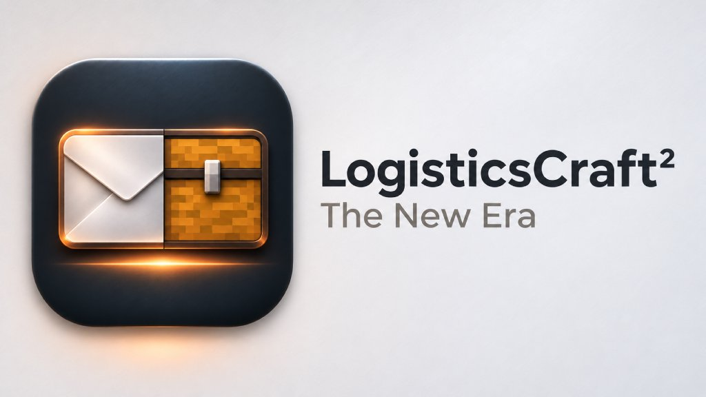

<h1> 物流时代2：新纪元 (LogisticsCraft²: The New Era)</h1>

**简体中文** · [English](README.en.md)



**物流时代2：新纪元（`lc2`）** 是 [工业时代2：新纪元 (IndustrialCraft²: The New Era)](https://github.com/spectrum527/IndustrialCraft2-The-New-Era) 的独立物流附属模组，为主模组加入可跨未加载区块运行的电动智能运输船与货运无人机。

## 下载与安装

请先安装对应 Minecraft 版本的 **IndustrialCraft²: The New Era (`ic2` v1.0.5+)**，再将下表中对应版本的 `lc2` JAR 放入 `mods/` 目录。联机时客户端和服务端都需要安装。

[v1.1.1 发行说明](https://github.com/spectrum527/LogisticsCraft2-The-New-Era/releases/tag/v1.1.1) · [SHA-256 校验](https://github.com/spectrum527/LogisticsCraft2-The-New-Era/releases/download/v1.1.1/SHA256SUMS.txt)

| Minecraft | 加载器 | Java | 下载 |
| --- | --- | ---: | --- |
| 1.19.2 | Forge 43.5.0 | 17 | [Forge 1.19.2 JAR](https://github.com/spectrum527/LogisticsCraft2-The-New-Era/releases/download/v1.1.1/lc2-forge-1.19.2-1.1.1.jar) |
| 1.21.1 | NeoForge 21.1.265 | 21 | [NeoForge 1.21.1 JAR](https://github.com/spectrum527/LogisticsCraft2-The-New-Era/releases/download/v1.1.1/lc2-neoforge-1.21.1-1.1.1.jar) |
| 26.1.2 | NeoForge 26.1.2.128 | 25 | [NeoForge 26.1.2 JAR](https://github.com/spectrum527/LogisticsCraft2-The-New-Era/releases/download/v1.1.1/lc2-neoforge-26.1.2-1.1.1.jar) |
| 26.2 | NeoForge 26.2.0.95 | 25 | [NeoForge 26.2 JAR](https://github.com/spectrum527/LogisticsCraft2-The-New-Era/releases/download/v1.1.1/lc2-neoforge-26.2-1.1.1.jar) |

## 上手教程

模组包含水路和空路两套运输系统：水路用**智能港口 + 电动智能运输船**，空路用**货运基站 + 运输无人机**。两种站点共用同一套货区、供电与升级规则。全部合成配方可在游戏内配方查询模组或 [设计文档](docs/DESIGN.md) 中查看。

### 站点货区与供电

智能港口和货运基站内部都有 54 格货仓，左右分成两半，避免刚卸下的货又被装回载具。

- **待发货区（左，27 格）**：放准备运走的货物。用漏斗、管道或 IC2 抽入升级送货，物品都会进这里；发船或放飞时只装这一区的货（货舱未满时会继续从相邻容器拉货）。原版红石比较器也只检测这一区的装满程度，方便接出“有货发车”或“满仓发车”的红石电路。
- **存储区（右，27 格）**：接收入站卸载的货物。载具到站后会先往相邻容器里卸货，装不下的暂存在这里；漏斗、管道和 IC2 弹出升级只从这一区往外取货。
- **一键互换（`<->`）**：界面两区中间有互换按钮，点一下就能把待发货区和存储区的 27 格物品直接对调，中转或回运时不用一格一格搬。

供电支持 EU 导线和一次性电池两种方式，界面右上角可切换 **EU 优先** 或 **电池优先**（优先项不够时会自动改用另一项，不会混扣）。

- **EU 供电**：六个面都能直接连 IC2 导线，内置 **14,400 EU** 缓存，默认接受 **LV（32 EU/t）** 输入。
- **一次性电池**：右侧电池槽只接收 IC2 的一次性电池（`ic2:single_use_battery`）。

### 水路运输：智能港口与电动智能运输船

水路适合跨海、沿河或挖运河运送大宗货物，单艘船有 **54 格**货舱（等同大箱子）。

1. **建造两个港口**：在起点和终点水边各放一个**智能港口（`lc2:smart_port`）**，尽量让正面朝向水面（方向放歪可用 IC2 扳手旋转）。两个港口之间需要有连通的水道，1 格宽的运河也能通航。
2. **停靠运输船**：手持**电动智能运输船（`lc2:electric_cargo_boat`）**右键智能港口，或直接把船放到港口旁的水里即可靠泊。停靠时，潜行右键可查看船舱，普通右键可登船。
3. **设定目标与供电**：打开起点港口界面，可以给站点命名方便识别，再用 `<` / `>` 选择同维度的目标港口（或手填 X/Y/Z 坐标后点设定），按需开启**自动返航**，并接好 EU 电源或放入一次性电池。
4. **装货发船**：往待发货区放入货物（或在港口旁放箱子等容器），点界面里的**发车**按钮，或给港口输入红石信号即可出航。

水路按单程或往返固定计费，并支持随船乘坐与自动避撞。

- **能耗**：单程消耗 **3,000 EU** 或 **2 节一次性电池**。开启自动返航会在发船时一次性扣除双倍（**6,000 EU** 或 **4 节电池**），船到对岸卸完货后自己开回来。
- **随船乘坐**：想坐船同行，需要在发船前先坐上船，再由红石信号触发发船。船已经自动开动时无法中途登船。
- **多船避撞**：在 3 格及以上宽度的水域中，船会靠右行驶；进入窄运河会自动错船让行，避免卡死。

### 空路运输：货运基站与运输无人机

空路适合翻山越岭、跨基地直连，或用多台无人机同时跑不同航线。每座**货运基站（`lc2:cargo_station`）**顶部有 **6 个无人机停机位**。

1. **放置基站并装射频芯片**：在起点和终点各放一个货运基站，顶面留出垂直起降空间。打开基站界面，在中间左侧槽位装入一枚**射频芯片**（不装芯片无法工作），芯片等级决定最远航程。
2. **放上无人机**：把**运输无人机（`lc2:transport_drone`）**或**重型运输无人机（`lc2:heavy_transport_drone`）**放入基站界面的 6 个停机位槽中，基站顶面会直接显示停靠的无人机。
3. **选目标、供电并起飞**：选择同维度且在射频范围内的目标基站，接好电源或放入一次性电池，把货放进待发货区，点**发车**或输入红石信号即可放飞。目标基站 6 个机位全满时会拒绝起飞，起飞后会自动为这架无人机预留目标机位。

无人机单程能耗按曼哈顿距离（`|dx| + |dy| + |dz|`）分三档计费，重型无人机耗能是普通型的两倍。

| 射频芯片 | 最远距离 | 普通无人机（12 格，16 格/秒） | 重型无人机（36 格，10 格/秒） |
| --- | ---: | --- | --- |
| 射频芯片 I（`rf_chip_1`） | 256 格 | 800 EU 或 1 节电池 | 1,600 EU 或 2 节电池 |
| 射频芯片 II（`rf_chip_2`） | 512 格 | 2,000 EU 或 2 节电池 | 4,000 EU 或 4 节电池 |
| 射频芯片 III（`rf_chip_3`） | 1,024 格 | 7,000 EU 或 5 节电池 | 14,000 EU 或 10 节电池 |

- **自动返航由目标站付费**：开启自动返航后，去程由起点站扣费，卸货后的返程由**目标站**扣费。如果目标站电量不足或起点站机位已满，无人机会安全停在目标机位等待，条件满足后自动返航。
- **空中避撞**：无人机采用垂直起降，去程、返程及多条并发航线会自动分高度巡航，空中接近时会动态错层避让。

### 跨未加载区块、无人值守与 IC2 联动

- **跨未加载区块运行**：运输船和无人机离开已加载区块后，会自动转为服务端后台模拟，沿途不需要铺区块加载器，退出重进存档也能接着跑。
- **区块加载升级（`lc2:chunk_loading_upgrade`）**：如果希望玩家不在基地时站点也能自动发车和收货，在起点和终点站右侧升级槽放一张区块加载升级即可。通电时消耗 **2 EU/t** 维持自身周围 **3×3 区块**加载，断电或取下会立刻释放。
- **容器与 IC2 升级**：站点紧贴原版箱子（含大箱子）、木桶或潜影盒就能互通，也支持 IC2 储物箱。右侧 4 个升级槽兼容 IC2 常用机器升级，包括变压器、储能和超频升级，也可以装弹出、抽入（含高级版）以及红石信号反转升级，并兼容 The One Probe 和 IC2 扳手。

## 从源码构建

### 准备环境

- **JDK**：按构建目标准备对应 JDK。Forge 1.19.2 用 **Java 17**，核心单测与 NeoForge 1.21.1 用 **Java 21**，NeoForge 26.1.2 与 26.2 用 **Java 25**。
- **Python 3**：构建时会自动调用 `src/datagen/generate_resources.py` 生成方块模型、配方和战利品表。

### 放入 IC2 依赖 JAR

前往 [IndustrialCraft²: The New Era Releases](https://github.com/spectrum527/IndustrialCraft2-The-New-Era/releases) 下载对应版本的 `ic2` v1.0.5 JAR，在仓库根目录新建 `.ic2-deps/` 文件夹并按原文件名放入。

```text
.ic2-deps/
├── ic2-forge-1.19.2-1.0.5.jar
├── ic2-neoforge-1.21.1-1.0.5.jar
├── ic2-neoforge-26.1.2-1.0.5.jar
└── ic2-neoforge-26.2-1.0.5.jar
```

> 根目录 Gradle 在配置阶段会检查全部三个 NeoForge 子项目，构建任一 NeoForge 版本时，三个 NeoForge 版 IC2 JAR 都需要放在 `.ic2-deps/` 中；只构建 Forge 1.19.2 时只需 `ic2-forge-1.19.2-1.0.5.jar`。

### 运行构建命令

在仓库根目录执行下列命令（Windows 请把 `./gradlew` 换成 `gradlew.bat`）。

```sh
# 跑核心单测并构建全部三个 NeoForge 版本
./gradlew :checkCommonImports :test:test :neoforge:1.21.1:jar :neoforge:26.1.2:jar :neoforge:26.2:jar

# 只构建单个 NeoForge 版本（以 1.21.1 为例）
./gradlew :neoforge:1.21.1:jar

# 构建 Forge 1.19.2 重混淆发行包（独立工程，需 Java 17）
./forge-1.19.2/gradlew -p forge-1.19.2 build reobfJar
```

### 构建产物位置

构建完成后，各版本 JAR 会输出到对应模块的 `build/libs/` 目录，直接放入游戏 `mods/` 即可使用。

- NeoForge 1.21.1：`src/neoforge/1.21.1/build/libs/lc2-neoforge-1.21.1-1.1.0.jar`
- NeoForge 26.1.2：`src/neoforge/26.1.2/build/libs/lc2-neoforge-26.1.2-1.1.0.jar`
- NeoForge 26.2：`src/neoforge/26.2/build/libs/lc2-neoforge-26.2-1.1.0.jar`
- Forge 1.19.2：`forge-1.19.2/build/libs/lc2-forge-1.19.2-1.1.0.jar`

更多工程规格见 [设计文档](docs/DESIGN.md)、[GUI 布局](docs/GUI_LAYOUT.md) 与 [无人机模型 UV](docs/DRONE_MODEL_UV.md)。

## 许可证

本项目代码采用 [GPL-3.0-only](LICENSE) 开源许可，原创像素美术采用 CC BY-SA 4.0 许可。
